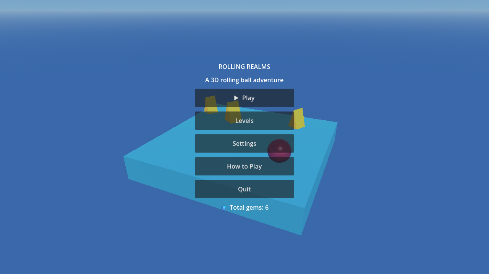
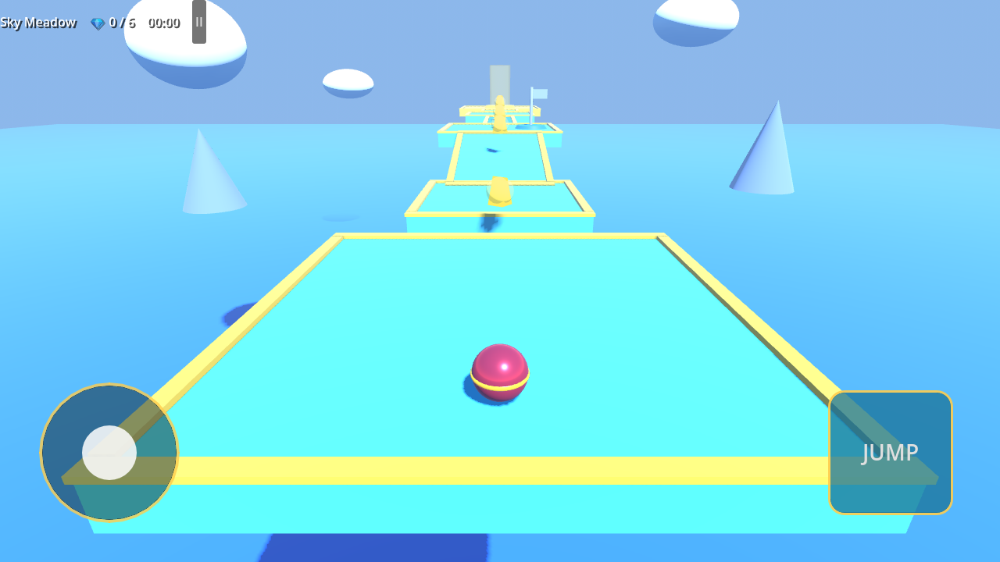
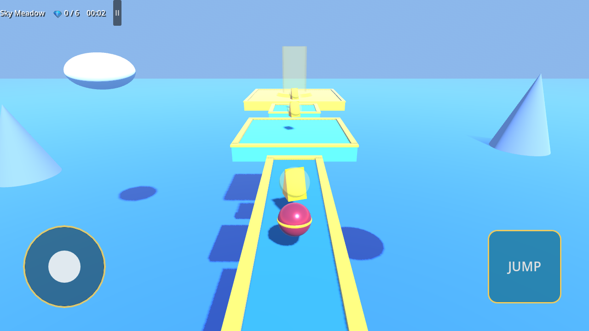
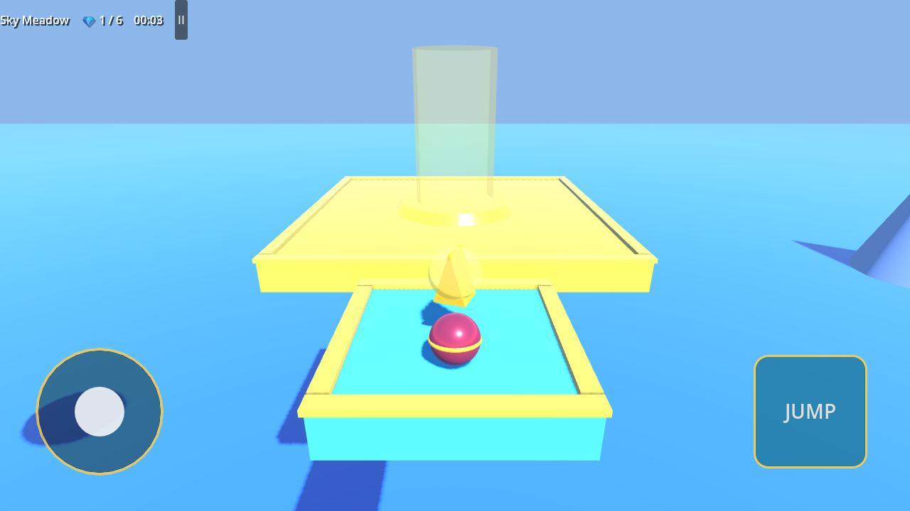

# Rolling Realms — 3D Rolling Ball Adventure

A complete, playable 3D ball-platforming game built with **Godot 4.7** and GDScript.
Roll a shiny ball across floating sky islands, dodge sweepers and lava, ride moving
platforms, grab golden gems, hit checkpoints, and reach the finish pad in 3 levels.

## Features (implemented and tested)

- Rolling ball controller (`CharacterBody3D`): acceleration, friction, air control,
  coyote time, jump buffering, visual rolling, slope handling.
- Third-person follow camera with SpringArm collision, mouse right-drag orbit,
  and touch-drag orbit that ignores the joystick area.
- 3 levels: **Sky Meadow** (tutorial), **Crystal Bridges** (precision + timing),
  **Skyfall Challenge** (hard finale with lift, sweepers, lava).
- Reusable objects: static platform, ramp, narrow bridge, moving platform,
  rotating sweeper, lava hazard, gem collectible, checkpoint, finish pad, fall zone.
- Gems with spin/bob animation, one-shot collection, sparkle particles, HUD counter,
  per-level totals, persistent grand total.
- Checkpoints with flag color change, respawn that never clips into geometry.
- Hazards + falling reset to the latest checkpoint with velocity cleared.
- Main menu (Play / Levels / Settings / How to Play / Quit), level select with
  lock state and best times, pause menu, level-complete screen with stats,
  best-time tracking and Next/Replay/Menu.
- Settings that work: master/music/SFX volume, camera sensitivity, touch UI mode.
- Procedural sound effects (no audio files needed): jump, gem, checkpoint,
  hurt, respawn, win jingle, UI click.
- JSON save (`user://rolling_realms_save.json`): unlocked/completed levels,
  total gems, best times, audio + camera prefs. Survives restarts.
- Touch controls: virtual joystick (bottom-left), JUMP button (bottom-right),
  pause button (top bar). Auto-shown on touch devices, overridable in Settings.
- Game feel: speed-reactive rolling sound, ball motion trail, landing dust with
  squash-and-stretch, checkpoint bursts, finish fireworks, screen flash on
  respawn/victory, click sounds on every button, live 3D diorama behind the menu.
- Windows `.exe` and Android debug `.apk` built and tested from this project.

## Screenshots (captured from the running game)






## Requirements

- Godot Engine **4.7.2 stable** (project targets 4.x, Compatibility renderer).
- Windows export templates: installed with Godot (used for the `.exe`).
- Android export: Android SDK + JDK 17+ configured in Godot's Editor Settings
  (used for the test APK below). Web export: Web templates, **not installed here**.

## Open the project

1. Install Godot 4.7.2.
2. Open Godot → **Import** → select `D:\3D ball\project.godot` (or copy the folder).
3. Press **F5** (or the Play button). The main menu opens.

## Run the game

- In the editor: open `scenes/menus/main_menu.tscn` (already the main scene) and press F5.
- Or run the built Windows game: `build/windows/RollingRealms.exe`.

## Controls

**PC (keyboard + mouse)**

| Action | Key |
|---|---|
| Move | W A S D / Arrow keys |
| Jump | Space |
| Restart from checkpoint | R |
| Pause / resume | Esc or P |
| Orbit camera | Hold right mouse button and drag |

**Android / touch**

- Left virtual joystick: move (large touch target, bottom-left).
- **JUMP** button: jump (bottom-right).
- **II** button (top bar): pause.
- Drag on the right half of the screen: orbit camera.

## Headless tests (no editor needed)

```powershell
$godot = "<path-to>\Godot_v4.7.2-stable_win64_console.exe"
& $godot --headless --script res://tests/validate_scenes.gd  # 19 scenes + autoloads
& $godot --headless --script res://tests/runtime_test.gd     # physics gameplay test
& $godot --headless --script res://tests/slope_check.gd      # ramp direction test
```

`runtime_test.gd` plays Level 1 with synthetic input through the real physics
engine and asserts: forward movement, no fall-through, jump height, single gem
count, live HUD counter, checkpoint spawn update, fall respawn, pause/resume,
level completion, and save-file persistence. Last run: **12/12 PASS**.

## Android build (tested 2026-10-16)

Prerequisites (all found on this machine):

- Android SDK with platform-tools, build-tools, one `platforms/android-*`
  (Editor Settings → Export → Android → Android Sdk Path).
- JDK 17+ (Editor Settings → Export → Android → Java Sdk Path).
- Debug keystore auto-created by Godot on first export.

Build a debug APK (classic, non-Gradle build — no Gradle setup needed):

```powershell
& $godot --headless --export-debug "Android" "build/android/RollingRealms-debug.apk"
```

Install on a device (USB debugging on):

```powershell
adb install -r build\android\RollingRealms-debug.apk
```

Release/AAB store builds need a release keystore and `gradle_build/use_gradle_build`
— see `export_presets.cfg` preset `Android` and the Godot docs.

## Web export (preset provided, NOT built here)

`export_presets.cfg` contains a `Web` preset (single-threaded, Compatibility
renderer, `canvas_resize_policy=2`). To build it you must first install the Web
templates for 4.7.2 (Editor → Manage Export Templates → Download, or copy the
`web_*` files into `%APPDATA%\Godot\export_templates\4.7.2.stable\`), then:

```powershell
& $godot --headless --export-release "Web" "build/web/index.html"
```

Serve the `build/web/` folder over HTTP (e.g. `python -m http.server`) — the
`file://` protocol does not work. Browser `user://` saves map to IndexedDB and
may be cleared by the browser; desktop/mobile saves persist normally.

## Project structure

```text
project.godot / export_presets.cfg / icon.svg / README.md
scenes/
  menus/  main_menu.tscn  level_select.tscn  settings_menu.tscn
  player/ ball_player.tscn
  levels/ level_01_sky_meadow.tscn  level_02_crystal_bridges.tscn
          level_03_skyfall_challenge.tscn
  objects/ collectible.tscn  checkpoint.tscn  moving_platform.tscn
           rotating_obstacle.tscn  hazard.tscn  finish_trigger.tscn
           static_platform.tscn
  ui/ gameplay_hud.tscn  mobile_controls.tscn  pause_menu.tscn
      level_complete.tscn
scripts/
  player/ ball_controller.gd  follow_camera.gd
  objects/ collectible.gd  checkpoint.gd  finish_trigger.gd
           moving_platform.gd  rotating_obstacle.gd  hazard.gd
  levels/ level_base.gd
  managers/ game_manager.gd  audio_manager.gd
  save/ save_manager.gd
  ui/ main_menu.gd  level_select.gd  settings_menu.gd  gameplay_hud.gd
      pause_menu.gd  level_complete.gd  virtual_joystick.gd
tests/ validate_scenes.gd  runtime_test.gd  test_checklist.md
build/ windows/  android/   (generated, not committed)
```

Autoloads: `SaveManager`, `AudioManager`, `GameManager` (only these three —
everything else communicates with signals and group calls).

## Custom audio (optional)

Sound effects are generated in code by `scripts/managers/audio_manager.gd`, so the
game has zero missing-file risk. To use your own files, drop `.wav`/`.ogg` files
into `assets/audio/` (create the folder) and replace the `_streams[...]` lines
with `load("res://assets/audio/jump.wav")` etc. Keep the same dictionary keys:
`jump, collect, checkpoint, hurt, respawn, win, click`.

## Troubleshooting

- **Ball falls through platform**: collision shapes are on every platform; if you
  edit a level, make sure each `StaticBody3D` has a `CollisionShape3D` child.
- **Buttons do nothing**: check the node paths in `scripts/ui/*.gd` match the
  `.tscn` names — `tests/validate_scenes.gd` catches this headlessly.
- **Touch controls never show on desktop**: Settings → Touch UI → "Always show".
- **App icon missing on the phone / game won't start, although `adb install`
  says Success**: check the phone is NOT in **Safe mode** (text in a corner of
  the screen). Safe mode hides all downloaded apps. Restart the phone normally
  to leave it. On Xiaomi phones this was the entire problem once.
- **Remote `adb shell am start` fails for third-party apps but works for
  system apps**: that is a phone restriction, not a broken APK. Verify with a
  known app (e.g. inDriver/Chrome): if it fails the same way, tap the icon on
  the phone screen instead.
- **Android export fails**: re-check the SDK and JDK paths in Editor Settings;
  run with `--verbose` to see which tool is missing.
- **Web audio delayed**: browsers require a user gesture before audio starts;
  the first click enables it.

## Current limitations (honest)

- Web export preset exists but was **not built or browser-tested** here (Web
  export templates not installed). No claim is made about specific browsers.
- APK tested as a **debug build only** (exports + installs); not play-tested on
  a physical touch device in this session — touch input uses Godot's standard
  touch pipeline plus `emulate_mouse_from_touch`.
- No background music track (SFX system + hooks are in place; add a loop to
  `audio_manager.gd` if you have a file).
- Visuals use primitive meshes + vertex-colored materials (no external art).

## Future improvements

- Soundtrack + rolling-loop sound with `assets/audio/` files.
- More levels, moving hazards variety, double-jump power-up.
- Gamepad support, camera auto-align option, speedrun ghost.
- Full web-template install + hosted playable link.
